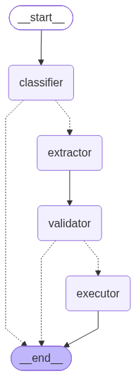

# Order Intake Observability

A four-step LangGraph pipeline that turns customer emails into orders, traced
with MLflow. It exists to show one failure for real: every step reports
success, and the order is wrong.

Video: link to be added.

## The failure

A customer writes:

> Same as last month, but double the bolts.

Last month they ordered 200 bolts, 200 nuts and 400 washers. So the right
order is 400 bolts, 200 nuts and 400 washers. This is what v1 of the pipeline
does with it:

```
Email 03 from client-co, extractor v1
✓ classifier ok       order: The email references a previous order ('same as...
✓ extractor  ok       5 items: 2 BOLT-M8, 1 NUT-M8, 2 WASHER-M8, +2 more
✓ validator  ok       5 items in catalog and in range
✓ executor   ok       order ORD-D8A72B saved, confirmation in outbox/

Status: completed
Order:  ORD-D8A72B
      2 x BOLT-M8
      1 x NUT-M8
      2 x WASHER-M8
      1 x ANCHOR-M10
      1 x BRACKET-L50
```

Four green lines. Two bolts instead of 400, and two products the customer has
never ordered. Nothing in the logs says so.

The trace shows where it went wrong. The Extractor made one model call, had
nothing to look "last month" up in, and had to return a quantity for every
item. So it invented them.

## The fix

v2 changes three things ([details](docs/v1-to-v2.md)):

1. The Extractor gets a `get_last_order` tool.
2. Its answer may say a quantity is `unknown`, or that it needs clarification.
3. The Validator sends anything unknown to a person instead of rejecting it.

```
Email 03 from client-co, extractor v2
✓ classifier ok       order: The email references a previous order ('same as...
✓ extractor  ok       3 items: 400 BOLT-M8, 200 NUT-M8, 400 WASHER-M8
✓ validator  ok       3 items in catalog and in range
✓ executor   ok       order ORD-91FEB6 saved, confirmation in outbox/
```

In the trace, the difference is one new span under the Extractor:
`get_last_order`.

When there is nothing to look up, v2 stops instead of guessing:

```
Email 05 from northwind-build, extractor v2
✓ classifier ok       order: The email explicitly states 'Order' in the subj...
✓ extractor  ok       no items, asks for clarification
! validator  review   The email refers to 'the usual,' but no previous order...

Status: needs_review
```

## The pipeline



| Step | What it does | Uses an LLM |
|---|---|---|
| Classifier | Decides whether the email is an order | Yes |
| Extractor | Turns the email into items and quantities | Yes |
| Validator | Checks the items against the catalog | No |
| Executor | Saves the order and writes the confirmation | No |

Two of the four steps are plain Python. The run stops early if the email is not
an order, or if the Validator answers `rejected` or `needs_review`.

## Run it

You need [uv](https://docs.astral.sh/uv/) and a free Mistral API key from
<https://console.mistral.ai/api-keys>.

```
uv sync
cp .env.example .env        # then put your key in .env
uv run python run.py --email 03 --version v1
uv run python run.py --email 03 --version v2
```

To look at the traces:

```
uv run mlflow ui --backend-store-uri sqlite:///mlflow.db
```

Open <http://localhost:5000>, choose the `order-intake` experiment, then the
Traces tab. Each run prints its trace ID. Traces can be filtered by tag, for
example `tags.prompt_version = 'extractor-v1'` or `tags.order_id = 'ORD-...'`.

To start again from a clean state:

```
uv run python reset.py          # database and outbox/
uv run python reset.py --all    # the same, and the MLflow traces
```

## The five emails

The emails are files in `data/emails/`. Nothing is read from a real inbox.

| Email | Content | v1 | v2 |
|---|---|---|---|
| 01 | 100 bolts and 50 brackets, stated | `completed`, as stated | `completed`, as stated |
| 02 | A question about lead times | `not_an_order` | `not_an_order` |
| 03 | "Same as last month, but double the bolts" | `completed`, wrong order | `completed`: 400 bolts, 200 nuts, 400 washers |
| 04 | A product that is not in the catalog | `rejected`, unknown SKU | `rejected`, unknown SKU |
| 05 | "The usual please", from a customer with no history | `completed`, invented order | `needs_review` |

## Tests

```
uv run pytest            # 110 offline tests, no API key needed
uv run pytest -m live    # 14 tests that call Mistral
```

The live tests check every row of the table above except email 05 on v1,
which is recorded as observed and not asserted.

## What to know before trusting this demo

- **Every run shown is real.** No output is mocked and no number is edited.
- **The model was chosen because it fails.** The model is Mistral's
  `ministral-14b-2512`. Two larger reasoning models (`openai/gpt-oss-120b` and
  `openai/gpt-oss-20b` on Groq) were tried first and would not guess: they
  returned no items or refused. A model that guesses is the one that needs
  tracing.
- **The wrong order is not always identical.** Over six v1 runs of email 03
  the washers came out as 2 four times and 1 twice, at temperature 0.
  Everything else was the same each time.
- **How the answer is requested changes what v1 invents.** The pipeline asks
  for JSON matching a schema. With function calling instead, v1 returned only
  "2 bolts". JSON-schema mode was chosen so that the v1 trace shows no tool
  call at all, because no tool exists in v1.
- **v2 looks up the last order more often than it needs to.** It also calls
  `get_last_order` for emails 01 and 04, which state their own items. The
  result is still right, and the extra lookup is visible in the trace.
- **The model cannot choose whose history it reads.** The lookup always uses
  the customer resolved from the sender address, whatever the model asks for.
- **No email is sent.** The confirmation is written to `outbox/`.
- **The cost in MLflow is an estimate.** MLflow works it out from list prices.
  The runs were made on Mistral's free tier.

## Layout

```
data/
  seed.py            creates the SQLite database
  emails/            01.json to 05.json
app/
  graph.py           LangGraph wiring
  nodes/             classifier, extractor (v1 and v2), validator, executor
  tools.py           get_last_order
  schemas.py         the shapes the model must answer in
  tracing.py         MLflow setup and trace tags
  console.py         terminal output
  llm.py, db.py, state.py, config.py
docs/
  graph.png          the pipeline diagram
  v1-to-v2.md        the three changes
tests/
run.py               python run.py --email 03 --version v1
reset.py             back to a clean state
```
